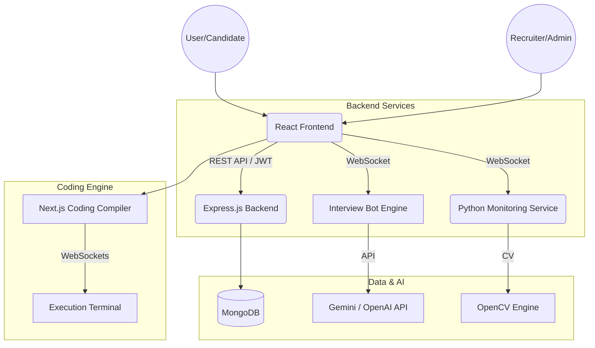
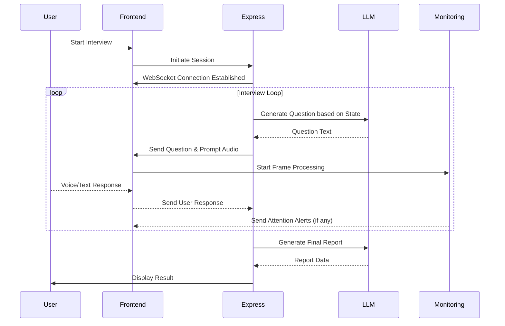
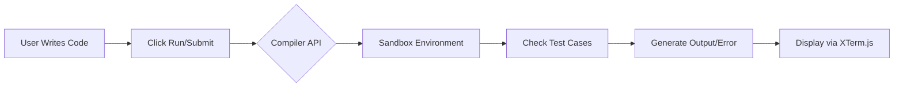

# Project Report: AI-Powered Placement Portal

## 1. Executive Summary
This project is a comprehensive AI-driven recruitment and placement platform. It simplifies the hiring lifecycle for organizations and empowers job seekers with advanced tools, including an AI Interview Bot, an Integrated Coding Module, and a Proctoring Monitoring System. By leveraging state-of-the-art Generative AI and Computer Vision, the platform provides a holistic environment for skill assessment and placement.

---

## 2. Technologies Used

### Frontend
- **React.js & Vite**: Core framework for a fast, modern interactive UI.
- **Next.js**: Powering the high-performance Coding Compiler interface.
- **Redux Toolkit**: Centralized state management for user authentication, job listings, and application status.
- **Tailwind CSS & Shadcn/UI**: Modern styling system with a focus on accessibility and responsiveness.
- **Monaco Editor**: Powering the coding IDE (the same editor behind VS Code).
- **XTerm.js**: Real-time terminal emulation for code execution results.
- **Framer Motion**: Smooth animations and micro-interactions for a premium feel.

### Backend
- **Node.js & Express.js**: Scaleable server-side infrastructure.
- **MongoDB & Mongoose**: NoSQL database for flexible data modeling (Jobs, Companies, Users, Problems).
- **Socket.io**: Real-time, bi-directional communication for interview bot interactions.
- **FastAPI (Python)**: High-performance backend for the Computer Vision monitoring service.

### AI & Specialized Tools
- **Google Gemini & OpenAI GPT**: Powering the Interview Bot and Resume AI logic.
- **Groq SDK**: High-speed inference for low-latency AI responses.
- **OpenCV**: Computer Vision library for real-time face detection and attention tracking.
- **Puppeteer & PDF-Parse**: Automated PDF generation for reports and resume analysis.

---

## 3. System Architecture

The platform follows a modular, distributed architecture composed of several interconnected services:

### Architecture Components
1. **Application Server (Express)**: The central hub managing authentication (JWT), database operations, and orchestrating AI workflows.
2. **Monitoring Service (FastAPI)**: A specialized Python microservice that processes video frames using OpenCV to monitor user attention during interviews.
3. **Coding Infrastructure (Next.js/Docker)**: An isolated module for writing and executing code in a secure environment.
4. **Client-Side (React)**: A responsive SPA (Single Page Application) that interacts with all backend services through REST APIs and WebSockets.

### High-Level Architecture Diagram

---

## 4. Methods & Implementation

### Authentication & Security
- **JWT (JSON Web Tokens)**: Used for secure, stateless authentication across all services.
- **Bcryptjs**: Password hashing for secure storage.
- **Middleware**: Custom `isAuthenticated` middleware ensures that protected routes are only accessible to authorized users.

### Real-time Communication
- **WebSockets (Socket.io)**: Used to create an immersive interview experience, allowing the bot to "speak" (text-to-speech) and "listen" (speech-to-text integration) with minimal latency.

### AI Integration
- **Prompt Engineering**: Highly specialized system prompts are used to ensure the Interview Bot maintains professional decorum and provides relevant technical feedback.
- **RAG (Retrieval-Augmented Generation)**: (Implicitly) used to match user resumes with job descriptions to provide tailored interview questions.

---

## 5. Feature-wise Explanation

### 5.1 Interview Bot
An intelligent virtual interviewer capable of conducting complete technical and behavioral rounds.
- **Logic**: It dynamically analyzes the candidate's resume and job requirement to generate context-aware questions.
- **Feedback**: Provides a detailed report post-interview analyzing clarity, confidence, and technical accuracy.

### 5.2 Coding Compiler Module
A full-stack coding environment integrated into the platform.
- **Integrated IDE**: Uses Monaco Editor for syntax highlighting, auto-completion, and formatting.
- **Multi-language Support**: Supports C++, Python, Java, and JavaScript.
- **Test Case Execution**: Users can run code against hidden test cases with real-time output displayed via XTerm.js.

### 5.3 Proctoring & Monitoring Service (Interview Bot Addition)
Ensures the integrity of online assessments.
- **Face Detection**: Verifies the presence of the candidate throughout the interview.
- **Attention Tracking**: Monitors head movement and "looking away" patterns to suggest potential distractions or cheating.
- **Real-time Alerts**: Triggers warnings if the candidate's face is not detected or if suspicious patterns are identified.

### 5.4 Coding Questions Module (Admin)
A dashboard for administrators to manage the question bank.
- **CRUD Operations**: Admins can add, update, and delete coding problems.
- **Test Case Configuration**: Ability to define input/output pairs and difficulty levels.

---

## 6. Process Flowcharts

### 6.1 Interview Flow

### 6.2 Code Execution Flow

---

## 7. Conclusion
The AI-Powered Placement Portal merges advanced AI techniques with high-performance web architecture to provide a seamless recruitment experience. From automated resume building to AI-proctored interviews and coding challenges, the platform acts as a bridge between talented candidates and growing organizations.
